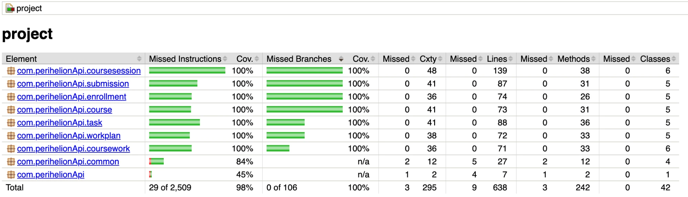

# Perihelion: Academic Planning and Assessment Service

A Java/Spring Boot REST service backed by SQLite. The current MVP supports CRUD
for courses, enrollments, coursework, submissions, work plans, tasks, and weekly
course sessions, plus an iCalendar (`.ics`) export of a course's sessions
(35 operations). Workload analysis, automatic work-plan generation, grading,
progress analysis, and Google Calendar integration are planned features. No
authentication is configured.

## Team

| Member | UNI |
| --- | --- |
| Giana Castro | gmc2196 |
| Daniel Keinan | dk3425 |
| Yabby Maelaf | ym3013 |
| Kamal Alasgarli | ka3088 |
| Wanting You | wy2470 |
| Ryan Shi | rs4669 |

## Build and run

Requires **JDK 21** and internet access for the initial dependency download. Maven
is provided through the wrapper. Run from the repository root; on Windows, use
`mvnw.cmd` instead of `./mvnw`.

```bash
mkdir -p data
./mvnw clean verify
./mvnw spring-boot:run
```

The service runs at `http://localhost:8080`; stop it with Ctrl+C. After building,
you can also run `java -jar target/project-0.0.1-SNAPSHOT.jar`.

Development data persists in `data/perihelion.db` across restarts. Startup runs
[schema.sql](src/main/resources/schema.sql) and Hibernate schema updates.
Database and connection settings are in
[application.properties](src/main/resources/application.properties).

## API documentation

See the **[API reference and usage examples](docs/api.md)** for endpoint
fields, validation, status codes, call order, and valid/invalid usage scenarios.

| Resource | Base path | List filters |
| --- | --- | --- |
| Courses | `/api/courses` | `title`, `code` |
| Enrollments | `/api/enrollments` | `courseId`, `learnerRef` |
| Coursework | `/api/coursework` | `courseId`, `kind` (`EXAM` or `ASSIGNMENT`) |
| Submissions | `/api/submissions` | `enrollmentId`, `courseworkId` |
| Work plans | `/api/workplans` | `enrollmentId` |
| Tasks | `/api/tasks` | `enrollmentId`, `workPlanId`, `courseworkId` |
| Course sessions | `/api/courses/{courseId}/sessions` | — |

Each resource supports POST and GET on its base path, and GET, PUT, and DELETE
on `/{id}`. Course sessions support PUT and DELETE on `/{sessionId}`, and
`GET /api/courses/{courseId}/calendar.ics` exports them as calendar events.
Create a course before its coursework and enrollments, then a work
plan before its tasks. Delete dependent records first; there are no cascading
deletes. Field rules, ordering, and 409 cases are in the API reference.

## Tests and code quality

Build dependencies and plugins are configured in [pom.xml](pom.xml).
Tests are grouped by resource and layer in [src/test/java](src/test/java), using
JUnit Jupiter and Mockito. MockMvc controller tests mock services; service tests
mock repositories. Integration tests use SQLite with the
[test profile](src/test/resources/application-test.properties), which selects an
in-memory database instead of the development database.

API tests (one `*ApiTest` class per resource, next to that resource's other
tests) start the whole application with `@SpringBootTest` and send real HTTP
requests through MockMvc, with nothing mocked. They use their own in-memory
database, and the shared setup is in
[ApiTestSupport](src/test/java/com/perihelionApi/ApiTestSupport.java).

```bash
# Style checks, tests, packaging, and coverage report
./mvnw clean verify

# Tests without generating the coverage report
./mvnw test

# API tests only
./mvnw test -Dtest='*ApiTest*'
```

- **Checkstyle 12.3.1**, via Maven plugin 3.6.0: custom Sun-based rules in
  [checkstyle.xml](checkstyle.xml), including 80-character lines, Javadocs, naming,
  imports, and whitespace. These are the same rules we used for the MiniProject.
  The build checks production sources; test sources are excluded in the POM.
  The Checkstyle report comes back clean.
- **JaCoCo 0.8.15**: records coverage during tests and generates reports during
  `verify`. No minimum-coverage enforcement is configured.
- **GitHub Actions**: [ci.yml](.github/workflows/ci.yml) runs Checkstyle and Maven
  verification on pushes and pull requests.

| Report | Generated location |
| --- | --- |
| Test results (Surefire) | `target/surefire-reports/` |
| Style findings | `target/checkstyle-result.xml` and console output |
| Coverage HTML | `target/site/jacoco/index.html` |
| Coverage XML / CSV | `target/site/jacoco/jacoco.xml` / `jacoco.csv` |

The minimum required branch coverage is 55%; the current test suite reaches
**100% branch coverage**.



API testing revealed **4 open bugs** that will be addressed: deleting a course
that still has coursework or course sessions, and creating or moving a course
session onto an occupied time slot, return a server error instead of 409. The
matching API tests are marked `@Disabled("Known bug: ...")` until they are fixed.

## Third-party software

Application and testing libraries are downloaded through Maven; dependency
versions are declared or managed through [pom.xml](pom.xml). Run
`./mvnw dependency:tree` for the resolved list. These include Spring Boot,
Hibernate, SQLite JDBC, JUnit, and Mockito, plus Checkstyle and JaCoCo plugins.
No other vendored third-party application code was identified during this review.

Included third-party build scripts: `mvnw`, `mvnw.cmd`, and
`.mvn/wrapper/maven-wrapper.properties` come from
[Apache Maven Wrapper](https://github.com/apache/maven-wrapper).
[checkstyle.xml](checkstyle.xml) is a custom configuration based on Checkstyle's
[Sun ruleset](https://github.com/checkstyle/checkstyle/blob/master/src/main/resources/sun_checks.xml).

## Project management

Tasks and individual contributions are tracked on our
[Jira board](https://perihelion-4156.atlassian.net/jira/software/projects/KAN/boards/1).

## AI Usage

AI was used for the development of this project. We track the model and number
of tokens at the top of files generated with the help of AI.
